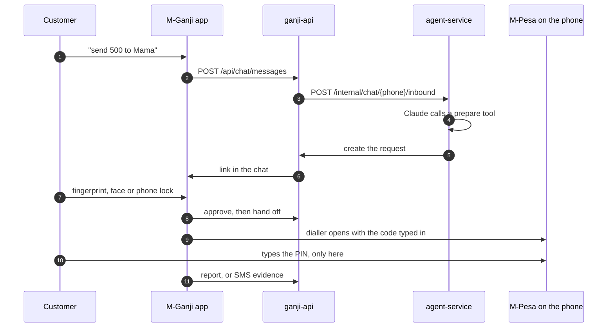

<!-- PLACE THIS FILE AT: mpesa-ai-agent/README.md
     Replace the existing file if there is one. The SVG images it uses go in mpesa-ai-agent/docs/assets/. You can delete this comment. -->

<div align="center">



<br/>


<br/><br/>

[The idea](#the-idea) &nbsp;|&nbsp; [The parts](#the-parts) &nbsp;|&nbsp; [Architecture](#architecture) &nbsp;|&nbsp; [Quick start](#quick-start) &nbsp;|&nbsp; [Ten looks](#ten-looks) &nbsp;|&nbsp; [Configuration](#configuration) &nbsp;|&nbsp; [Failing well](#failing-well) &nbsp;|&nbsp; [Known gaps](#known-gaps)


</div>

## The idea

Customers chat with an assistant in the app or on the web, in English or Swahili, by text, voice note, photo, video, file, shared contact or shared location. The assistant understands requests such as "send 500 to Mama", "pay Paybill 888880 account 1234" or "buy 50 airtime", and **prepares** them. The customer then approves on their own phone and finishes inside M-Pesa, using the system that already works.

> [!NOTE]
> **About the name.** *Ganji* is Sheng for money. M-Ganji is an assistant that helps people use their own M-Pesa, in a chat they already know how to use.
> M-Pesa and Daraja are Safaricom's names. This project uses them only to say what it works with.

<div align="center">

</div>

<div align="center">

</div>

<br/>

> [!IMPORTANT]
> This design deliberately does **not** do three things.
> It holds no M-Pesa API keys for customers, so it cannot move anyone's money. Only the customer can, inside M-Pesa.
> It never sees, asks for or stores the M-Pesa PIN. The assistant is told to refuse it if someone sends it.
> It cannot get a confirmation from Safaricom. The result is recorded as *reported by the customer* or *matches the message on the customer's phone*. Either way it is a record, not proof.

<div align="center">

</div>

<br/>

<div align="center">

</div>

## The parts

<div align="center">
<table>
<tr>
<td><a href="agent-service/README.md"></a></td>
<td><a href="ganji-api/README.md"></a></td>
<td><a href="ganji_app/README.md"></a></td>
</tr>
<tr>
<td><a href="payment-service/README.md"></a></td>
<td><a href="console/README.md"></a></td>
<td><a href="postman/README.md"></a></td>
</tr>
</table>
</div>

| Part | Port | Job | Needed |
|---|---|---|---|
| agent-service | 8082 | Talks to Claude, keeps each customer's chat and files, prepares requests with tools | Yes |
| ganji-api | 8084 | Signs customers in by SMS code, relays the chat to the agent, stores prepared requests, serves the app and its link files | Yes |
| ganji_app | none | Flutter app for Android, iOS, macOS, Linux and Windows: chat, find contacts, approve, hand over to M-Pesa, report | Yes |
| payment-service | 8083 | Daraja for a **business**: STK Push to your own shortcode, refunds, payouts, staff roles | Optional, off by default |
| console | 8000 | One HTML file that behaves like a frontend for every endpoint | For testing |
| postman | none | Collection and environment for every endpoint | For testing |

All Java services share the same layered packages: `controller`, `service`, `repository`, `model`, `dto`, `exception`, `config`.

<div align="center">

</div>

## Architecture

<div align="center">

</div>

<br/>

A single request, end to end:



<details>
<summary><b>How a request is kept safe</b></summary>

<br/>

- The assistant never moves money. It only calls "prepare" tools. The phone number on a request is the signed-in customer's number from their token, never something the model typed.
- Details are checked against a whitelist per type: Paybill and Till numbers are 5 to 7 digits, Kenyan numbers are normalised, amounts are limited, unknown fields are rejected, a request to your own number is refused.
- Details read from a voice note, photo or file are flagged in the app, and the assistant reads them back before preparing.
- A request belongs to one phone number. Another customer's link cannot open it. Links carry only a random id. Requests expire after 30 minutes if not approved.
- Sign-in needs a 6 digit code sent by SMS (valid 10 minutes, 5 tries, 3 codes an hour, stored hashed). The model never sees the code.
- Text found inside photos, documents and voice transcripts is treated as data, never as instructions.
- Contacts are searched on the phone. Your servers see only the one contact the customer chooses to share.

</details>

<details>
<summary><b>Request states and result levels</b></summary>

<br/>

A request moves through `CREATED`, `APPROVED`, `HANDED_OFF`, then `DONE_REPORTED` or `NOT_DONE`. It can also end as `DECLINED`, `CANCELLED` or `EXPIRED`.

| Result level | Meaning |
|---|---|
| NONE | Nothing reported yet |
| REPORTED | The customer said it was done, maybe with a code |
| SMS_AMOUNT | A message on their phone matched the amount, kind and time. It did not show who received it |
| SMS_MATCHED | As above, and the recipient number or Paybill account matched too |

None of these is a Safaricom confirmation. A message can also correct a request wrongly marked "not done", and one M-Pesa code can back only one request.

</details>

<details>
<summary><b>What the assistant can prepare</b></summary>

<br/>

| Customer says | Needs |
|---|---|
| Send money to a number or a contact | Number or contact name, amount |
| Pay a Paybill | Paybill number, account, amount |
| Pay a Till | Till number, amount |
| Pay Pochi la Biashara | Owner's number, amount |
| Buy airtime | Amount, and a number if not their own |
| Set up a Ratiba | What it pays, how often (daily, weekly, monthly), start date, optional end date |
| Show my requests, cancel one, record an M-Pesa code | Nothing |

</details>

<div align="center">

</div>

## Quick start

> [!WARNING]
> **Status: a reference build.** The code was written and then migrated to Spring Boot 4.1.2 with Jackson 3. agent-service has been seen starting on Boot 4 (Tomcat 11, RabbitMQ connected). payment-service and ganji-api are migrated but have not yet been confirmed running end to end. Nothing has been through a full end to end test. Verify the M-Pesa hand-off values and the SMS wording on real phones before relying on any of it.

**1. Prerequisites.** Java 21, Maven 3.9 or later, Docker, Flutter 3.22 or later, an Anthropic API key, and a public HTTPS address for ganji-api (a Cloudflare Tunnel is fine for testing). Real sign-in codes need an Africa's Talking account.

**2. Configure.** Copy each `.env.example` to `.env` in its own folder. Use the **same** `INTERNAL_KEY` everywhere.

**3. Run everything in Docker.**

```bash
docker compose up --build
```

**4. Or run a service from your IDE or the shell.**

```bash
docker compose up -d redis rabbitmq        # plus a database, see below
cd agent-service && mvn spring-boot:run
cd ganji-api && mvn spring-boot:run
```

**5. Check the build before trusting it.**

```bash
cd agent-service   && mvn clean verify
cd ganji-api       && mvn clean verify
cd payment-service && mvn clean verify
cd ganji_app && flutter pub get && flutter analyze && flutter test
```

**6. Try it without a phone.** Start ganji-api with `CODE_DELIVERY=dev`, then open the console.

```bash
cd console && python3 -m http.server 8000     # then open http://localhost:8000/console.html
```

<details>
<summary><b>Choosing the database</b></summary>

<br/>

Pick the database with `DATABASE_TYPE` (`mongodb`, `postgresql` or `mysql`). payment-service defaults to **MongoDB** when run directly, and the compose file starts PostgreSQL unless you say otherwise. Start the matching container with `docker compose --profile mongodb up` or `docker compose --profile mysql up`. MongoDB has no multi-record transactions, so prefer a SQL database for payment-service before real money. Trade-offs are in [`docs/DATABASES.md`](docs/DATABASES.md).

If PostgreSQL already has a data volume from an earlier run, the init script is skipped, so create the database once by hand:

```bash
docker compose exec postgres createdb -U app ganji
```

</details>

<details>
<summary><b>Sign-in code delivery</b></summary>

<br/>

`CODE_DELIVERY` decides how the sign-in code reaches the customer.

| Value | Behaviour | Use it |
|---|---|---|
| `log` | Writes the code to the ganji-api log. This is the default | Developer machine |
| `dev` | Also returns the code to the app and console so a test can sign in alone | Local testing only |
| `sms` | Sends a text through Africa's Talking (`SMS_USERNAME`, `SMS_API_KEY`, `SMS_SENDER_ID`) | Real use |

> [!CAUTION]
> Never use `dev` on a system other people can reach. Anyone could sign in as any phone number.

</details>

<details>
<summary><b>Hand-off values you must verify</b></summary>

<br/>

The app can dial a code with the details already typed in, or open the M-Pesa app. Those values are **not hard coded** because they were not verified. They live in the ganji-api `.env`:

```properties
HANDOFF_USSD_MAIN=*334#
HANDOFF_USSD_PAY_TILL=
HANDOFF_MPESA_ANDROID_PACKAGE=
HANDOFF_MPESA_IOS_URL=
```

Placeholders are `{amount}`, `{phone}`, `{paybill}`, `{account}` and `{till}`. The app only ever dials digits, `*` and `#`. Leave a template empty and the app dials the main M-Pesa menu and shows numbered steps with copy buttons. Confirm the real menu paths and app identifiers with the M-Pesa team, and test on a real phone with small amounts.

</details>

<div align="center">

</div>

## Ten looks

The Flutter app and the browser console share the same ten looks. Seven are everyday, three borrow the colours of M-Pesa. Pick one from the palette button in the app bar or the menu at the top right of the console. No screen hard-codes a colour, and a test checks that text on every look meets 4.5 to 1 contrast.

<div align="center">

</div>

<div align="center">

</div>

## Configuration

| Variable | Where | Meaning |
|---|---|---|
| `INTERNAL_KEY` | every service | Shared secret sent as `X-Internal-Key` between services. Use the same value everywhere |
| `ANTHROPIC_API_KEY` | agent-service | Lets the assistant answer. Without it, messages are accepted but nothing replies |
| `GANJI_TOKEN_SECRET` | ganji-api | 32 or more random characters, signs phone sessions |
| `GANJI_PUBLIC_BASE_URL` | agent-service, ganji-api | Public HTTPS address of ganji-api |
| `CODE_DELIVERY` | ganji-api | `log`, `dev` or `sms` |
| `DATABASE_TYPE` | services with a database | `mongodb`, `postgresql` or `mysql` |
| `MONGODB_URI` | when using MongoDB | Include `serverSelectionTimeoutMS=5000` so a missing database fails fast |
| `CORS_ALLOWED_ORIGINS` | any service the console calls | Leave empty in production. A wildcard is ignored on purpose |
| `AGENT_BUSINESS_PAYMENTS` | agent-service | `true` switches the optional Daraja tools on |

Each service reads a local `.env` file through `spring.config.import: optional:file:.env[.properties]`. Real environment variables always win over the file.

> [!NOTE]
> `.env` files hold real secrets. Never commit them. Run `git status` before every commit and make sure only `.env.example` is staged.

<div align="center">

</div>

## Failing well

One broken connection should not take the whole project down.

| Situation | What happens |
|---|---|
| Database is not up yet when a SQL service starts | Flyway retries the connection 6 times, 5 seconds apart, then stops with one clear message |
| Database or Mongo is unreachable at run time | Hikari gives up after 5 seconds, Mongo after `serverSelectionTimeoutMS=5000`, so requests do not hang |
| A payment call hits a database, query or RabbitMQ failure | payment-service answers **503 Service Unavailable** with a plain body, not a stack trace |

The retry and timeout values sit in the profile ymls, so they are easy to tune.

<div align="center">

</div>

## Android and iOS

| | Android | iOS |
|---|---|---|
| Dialler with the code filled in | Opens the dialler, the customer presses call | Same, with a system confirmation |
| Open the M-Pesa app | Possible by package name (not verified) | Only if it has a URL scheme (not verified) |
| Matching the M-Pesa SMS to a request | On request, with permission. See [`ganji_app/docs/SMS.md`](ganji_app/docs/SMS.md). Google Play restricts this permission | Not possible. The customer sends the message in the chat |
| Approval | Fingerprint, face or phone lock | Face ID, Touch ID or passcode |

## Voice, images and files

- **Voice notes** are recorded in the app or console and transcribed by a speech to text provider with an OpenAI compatible `/audio/transcriptions` endpoint. It is **off by default**. Turning it on sends customers' audio to that provider, so choose one you are allowed to use, tell your customers, and check your duties under the Kenya Data Protection Act. Names and numbers in transcripts can be wrong, so the assistant reads them back.
- **Spoken replies** are optional and off by default.
- **Images** (an M-Pesa message, an invoice, a Paybill sign) and **PDFs** go to the model. **Word, Excel, CSV and text** files are read on the server.
- Videos and unsupported files are kept in the chat, and the assistant says plainly that it cannot open them.

## Optional business payments

payment-service is the Daraja module for a **business**. It is not needed for personal wallet requests.

1. Start it with `docker compose --profile business up --build`.
2. Set `AGENT_BUSINESS_PAYMENTS=true` in the agent-service `.env`.
3. Follow [`payment-service/README.md`](payment-service/README.md) for Daraja setup, callbacks and the staff list.

With the switch off, the assistant is told nothing about these tools, the code refuses them, and every sender is a customer.

<div align="center">

</div>

## Known gaps

> [!CAUTION]
> **No proof of payment.** Confirmation codes come from the customer, or from an SMS on the customer's own phone on Android. That SMS can be faked on a modified phone, so do not release goods or large value to a third party on it alone. Verified status needs a business integration (Daraja) or Safaricom's own statement tools.

- **Safaricom terms.** Check Safaricom's terms and the app store rules for a third party app that hands over to M-Pesa. The design avoids automating USSD, touching the PIN and reading SMS in the background, but get this confirmed.
- No transactional outbox. If RabbitMQ is down when a customer reports, the acknowledgement in the chat can be lost.
- Request expiry is checked when a request is read, not by a timer. A request opened in M-Pesa never expires on its own.
- The chat is read by polling about every 1.5 seconds while the app is open. There is no push notification yet.
- SIM swap is a risk for any SMS sign-in.
- The Google and Microsoft contact sign-ins need your own OAuth client ids and were not run against real accounts. See [`ganji_app/docs/CONTACTS.md`](ganji_app/docs/CONTACTS.md).
- The phone check protects our approval step only. Whether a biometric or the device lock was used is a best guess recorded for the audit trail.
- The M-Pesa SMS patterns in `ganji_app/lib/models/mpesa_sms.dart` were written from memory. Test them with real messages.
- 503 handling is in payment-service. agent-service and ganji-api still need the same treatment in their exception handlers.
- No admin dashboard, offline mode or Swahili text in the app screens yet. The assistant itself replies in the customer's language.

## Security notes

- Only the ganji-api HTTPS paths (`/a/*`, `/api/*`, `/.well-known/*`) should be public. Keep agent-service (8082) private, and block `/internal/*` on ganji-api at your proxy.
- Every call between services carries `X-Internal-Key`.
- Phone sessions are signed tokens (30 days by default) that are revoked by signing the phone out.
- There are no M-Pesa customer secrets to leak because none are held.

## More reading

| Document | What is in it |
|---|---|
| [`FEATURES.md`](FEATURES.md) | Everything the system does today, for customers and for operators |
| [`docs/DATABASES.md`](docs/DATABASES.md) | PostgreSQL, MySQL and MongoDB: setup, trade-offs, what was tested |
| [`ganji_app/docs/CONTACTS.md`](ganji_app/docs/CONTACTS.md) | Contact search and the Google and Microsoft sign-ins |
| [`ganji_app/docs/SMS.md`](ganji_app/docs/SMS.md) | How the M-Pesa message check works and what it sends |
| [`ganji_app/docs/PLATFORM_SETUP.md`](ganji_app/docs/PLATFORM_SETUP.md) | Settings for each platform, signing and app links |

<div align="center">
<br/>
<sub>Built by Bill Graham Peacemaker, Nairobi. M-Pesa is a registered mark of Safaricom. This project is not affiliated with or endorsed by Safaricom.</sub>
</div>
