 

  

Put the production certificate in this folder.

<a href="../../../../../README.md">Back to agentx-api</a>

# Safaricom production public certificate

Put the **production** certificate here, for example `ProductionCertificate.cer`.

Get it from the Daraja portal (developer.safaricom.co.ke), in the documentation for the Security Credential.
The production certificate is different from the sandbox one: a SecurityCredential made with the wrong one is
rejected by Safaricom. It is a public certificate, so it is safe to commit to Git. It must be the certificate
Safaricom gives out, never a private key.

Any file ending in `.cer`, `.crt`, `.pem` or `.der` in this folder is accepted. If there are several, the first by
name is used.
