 

  

Certificates used by the tests only.

<a href="../../../../README.md">Back to agentx-api</a>

Throwaway certificates for the tests only. They were made with keytool and have nothing to do with Safaricom.
The .p12 files hold the matching private key (password: changeit) so a test can open what the code locked.
Never use these for anything real.
