<!-- PLACE THIS FILE AT: mpesa-ai-agent/companion-api/README.md
     Replace the existing file if there is one. The SVG images it uses go in mpesa-ai-agent/docs/assets/. You can delete this comment. -->

<div align="center">



<br/>

       

<br/><br/>

The front door. It signs customers in, relays the chat to the agent, stores prepared requests and serves the app.

<sub><a href="../README.md">Back to the project overview</a></sub>


</div>

## What it does

| Job | Detail |
|---|---|
| Sign in | A 6 digit code sent by SMS (valid 10 minutes, 5 tries, 3 codes an hour, stored hashed). The result is a signed session token tied to a device |
| Relay the chat | The app talks to this service. This service talks to agent-service. Nobody can read another number's chat or files |
| Store requests | Every request belongs to one phone number and moves through `CREATED`, `APPROVED`, `HANDED_OFF`, then `DONE_REPORTED` or `NOT_DONE` |
| Match evidence | Compares the code, kind, amount and payee from an M-Pesa message on the customer's phone with the request |
| Serve the app | Landing page for `/a/{id}`, the app's hand-off settings, and the Android and iOS link files |
| Publish events | Sends "customer reported" events to RabbitMQ |

> [!IMPORTANT]
> Only `/a/*`, `/api/*` and `/.well-known/*` should be public. Block `/internal/*` at your proxy.

## Package layout

```text
com.mpesaagent.companion
  CompanionApiApplication
  controller/   AuthController, AppActionController, ChatController,
                InternalActionController, LandingController, WellKnownController
  service/      sign-in, requests, evidence matching, chat relay
  repository/   database access, for the database you choose
  model/  dto/  entities and request and response shapes
  config/       typed properties, token filter, internal key filter, CORS, RabbitMQ
  exception/    GlobalExceptionHandler
```

## Run it

```bash
docker compose up -d redis rabbitmq        # plus a database
cd companion-api
cp .env.example .env                       # then edit it
mvn spring-boot:run
```

Start with `CODE_DELIVERY=dev` to sign in from the console without an SMS account. Run the tests with `mvn clean verify`.

## Endpoints

**Public, for the app** (session token required except sign-in)

| Method and path | Purpose |
|---|---|
| `POST /api/auth/request-code` | Ask for a sign-in code |
| `POST /api/auth/verify` | Trade the code for a session token |
| `DELETE /api/devices/me` | Sign this phone out |
| `GET /api/config` | Hand-off settings (dial codes, M-Pesa app ids) |
| `GET /api/actions`, `GET /api/actions/{id}` | List and read requests |
| `POST /api/actions/{id}/approve` | Approve after the phone check |
| `POST /api/actions/{id}/handoff` | Record that the dialler or M-Pesa was opened |
| `POST /api/actions/{id}/report` | Customer says it is done, or not done |
| `POST /api/actions/{id}/sms-evidence` | Send the parsed message fields for matching |
| `POST /api/actions/{id}/decline` | Decline |
| `GET`, `POST`, `DELETE /api/chat/messages` | Read, send and clear the chat |
| `POST /api/chat/media`, `GET /api/chat/media/{id}` | Upload and download chat files |
| `GET /a/{id}` | Landing page that opens the app |
| `GET /.well-known/assetlinks.json` and `apple-app-site-association` | App link files |

**Internal, for agent-service** (`X-Internal-Key` required)

| Method and path | Purpose |
|---|---|
| `POST /internal/actions` | Create a prepared request |
| `GET /internal/actions`, `GET /internal/actions/{id}` | List and read requests |
| `POST /internal/actions/{id}/cancel` | Cancel a waiting request |
| `POST /internal/actions/{id}/receipt` | Record an M-Pesa code against a request |
| `POST /internal/link-codes` | Create a link code |

## Configuration

| Variable | Meaning |
|---|---|
| `INTERNAL_KEY` | Shared secret for calls between services |
| `COMPANION_TOKEN_SECRET` | 32 or more random characters. Signs sessions |
| `COMPANION_PUBLIC_BASE_URL` | Public HTTPS address, used in links and the link files |
| `CODE_DELIVERY` | `log` (default), `dev` or `sms` |
| `SMS_USERNAME`, `SMS_API_KEY`, `SMS_SENDER_ID` | Africa's Talking, for `sms` |
| `DATABASE_TYPE` | `mongodb`, `postgresql` or `mysql`. See [`docs/DATABASES.md`](../docs/DATABASES.md) |
| `MONGODB_URI` | Add `serverSelectionTimeoutMS=5000` so a missing database fails fast |
| `HANDOFF_USSD_MAIN`, `HANDOFF_USSD_PAY_TILL`, `HANDOFF_MPESA_ANDROID_PACKAGE`, `HANDOFF_MPESA_IOS_URL` | Hand-off values. **Not verified, set them yourself** |
| Android package and signing fingerprint, iOS app id | So `/a/ID` links open the app directly |
| `CORS_ALLOWED_ORIGINS` | For the browser console only |

> [!CAUTION]
> `CODE_DELIVERY=dev` returns the sign-in code in the response. Anyone could sign in as any number. Never use it on a server other people can reach.

## Failing well

The profile ymls for PostgreSQL, MySQL and MongoDB carry the resilience settings: Flyway retries the connection 6 times, 5 seconds apart, Hikari gives up after 5 seconds, and the Mongo URI sets `serverSelectionTimeoutMS=5000`. A database that is still starting delays boot instead of crashing it, and one that is missing produces one clear failure.

> [!NOTE]
> The 503 answers for database and broker outages that payment-service has are not in this service yet. Add them to `GlobalExceptionHandler` the same way.

## Known gaps

- No transactional outbox. If RabbitMQ is down when a customer reports, the acknowledgement in the chat can be lost.
- Request expiry is checked when a request is read, not by a timer.
- The nested record properties for hand-off settings were not exercised on Boot 4. Check the startup log on first run.

<div align="center">
<sub>M-Pesa is a registered mark of Safaricom. This project is not affiliated with or endorsed by Safaricom.</sub>
</div>
