<!-- PLACE THIS FILE AT: mpesa-ai-agent/console/README.md
     Replace the existing file if there is one. The SVG images it uses go in mpesa-ai-agent/docs/assets/. You can delete this comment. -->

<div align="center">



<br/>


<br/><br/>

A single HTML file that acts like a frontend for the whole system. No packages, no internet needed.

<sub><a href="../README.md">Back to the project overview</a></sub>


</div>

## Run it

```bash
cd console
python3 -m http.server 8000
```

Open <http://localhost:8000/console.html>. Use `localhost`, not an IP address, because browsers only allow the microphone, camera and location on `localhost` or HTTPS.

## Let the page call your services

The browser blocks one origin calling another unless the service allows it. Each Spring service has an opt-in setting. Start every service you want to try with:

```properties
CORS_ALLOWED_ORIGINS=http://localhost:8000
```

Leave it empty in production. A wildcard `*` is ignored on purpose. The status lights at the top turn green when a service is reachable, and amber when it is running but this page is not allowed to call it.

Open **Settings** (the sliders icon, top right) to set the service addresses, the internal key, the callback secret, the customer phone numbers and the optional contact search client ids. They are kept in this browser only.

## What is on each tab

| Tab | What it does |
|---|---|
| **Journey** | Runs a whole request from chat to message check and draws it as a trace across five parties: customer, agent, M-Ganji API, phone app and M-Pesa. Solid lines are real calls, dashed lines are steps the console can only pretend (a fingerprint, the PIN, the M-Pesa message). Press any solid line to read its exact request and answer. You can make the M-Pesa message show a different number or account to see it refused. It needs no AI, because it uses the agent-side endpoints of ganji-api |
| **Chat** | The real chat with the real agent. Sign in with a phone number and the 6 digit code. The plus button opens the attach menu: photo, camera, video, record a video, audio file, document, contact and location. The microphone button records a voice note with a timer, live level, cancel and send. You can drag a file onto the chat or paste one. Buttons and menus the assistant sends can be tapped, and **Find in contacts** opens the contact finder. The chat is read every 1.5 seconds |
| **Phone** | The M-Ganji app on a phone: sign in, list, approve with a fingerprint, open M-Pesa, report, and check an M-Pesa message. Messages from M-Pesa are simulated and kept in this browser |
| **Explorer** | Every endpoint (78 of them) with an editable path, query and body, a send button, and the answer as body, headers, request and curl. Saved values such as the request id and phone token are filled in for you |

The dock at the bottom lists every call made, with its full request and answer. Press **Ctrl+K** (or Cmd+K) for the command palette: jump to a view, run the journey, switch theme or open any of the 78 endpoints by name.

> [!NOTE]
> For the console to receive the sign-in code, start ganji-api with `CODE_DELIVERY=dev`. Otherwise read it from the ganji-api log or your SMS.

## Ten looks

Picked from the menu at the top right and shared with the Flutter app.

<div align="center">

</div>

## Your logo

The M-Pesa logo is a registered mark and is not included. To brand the console, open Settings, choose your own logo under "Your logo" and it appears in the header and as the assistant's picture in Chat. It is resized and kept in this browser only.

## Contact search

The finder in Chat and in the Phone tab searches:

| Source | What you need |
|---|---|
| Google contacts, including people you have emailed | A Google OAuth **Web** client id in Settings. In Google Cloud enable People API, add this page's origin as an authorised JavaScript origin, and add the scopes `contacts.readonly` and `contacts.other.readonly` |
| Outlook and Microsoft 365 contacts | An Azure app registration with a **single-page application** redirect URI equal to this page's address, and the delegated permission `Contacts.Read`. Paste its Application (client) ID in Settings. The sign-in opens a popup and uses PKCE, so no secret is stored |
| This device's contacts | The browser's Contact Picker. Only Chrome on Android offers it |
| A `.vcf` or `.csv` file | Nothing to set up |
| Typing the number | Nothing to set up |

Contacts are searched in the browser. Only the contact you choose is sent, and only as a chat message. Tokens stay in memory. See [`../ganji_app/docs/CONTACTS.md`](../ganji_app/docs/CONTACTS.md).

## Files and voice notes in Chat

Files you attach are uploaded to ganji-api (`POST /api/chat/media`) and then named in the message you send, exactly as the app does. Chrome and Edge record voice notes as WebM and Safari as MP4. Check that your transcription step accepts WebM or MP4.

## Be careful

> [!CAUTION]
> This page holds the internal key and secrets in the browser. Use it on your own machine with test values, never with production keys. Do not turn on `CORS_ALLOWED_ORIGINS` or `CODE_DELIVERY=dev` on a server other people can reach.

- A matched message here is the simulator matching a message it made itself. It shows how the checks behave, not that money moved.
- Calls to payment-service and the Daraja callbacks only work with that service running and, for real payments, with Daraja credentials.

<div align="center">
<sub>M-Pesa is a registered mark of Safaricom. This project is not affiliated with or endorsed by Safaricom.</sub>
</div>
