 

  

Several chats for every customer. Start one, go back to an old one, rename it, pin it.

<a href="../README.md">Back to the project overview</a> &nbsp;|&nbsp; <a href="../FEATURES.md">Features</a> &nbsp;|&nbsp; <a href="PROFILE_AND_EMAIL.md">Profile and email</a>

# Many chats

A customer can keep several chats, the way Claude and ChatGPT do. They start a new chat, go back to an old one, rename it, pin it to the top and delete it.

## What the customer sees

| In the app | In the console |
|---|---|
| The **Chats** button in the chat's top bar opens the list. **New chat** is there and in the menu next to it. Tap a chat to open it. The three dots on a row rename, pin and delete. Swipe a row to the left to delete it. A search box appears once there are more than six chats. | The **Chats** panel next to the conversation, with **New chat**, a search box and one row per chat. Hover a row for rename, pin and delete. The top bar of the conversation shows the name of the open chat. |

- A new chat is named after the first thing the customer says. Renaming sets a name of up to 80 characters. Renaming to nothing goes back to the automatic name.
- Pinned chats stay at the top. The rest are ordered by the last message.
- Opening an old chat brings back its messages **and what the assistant remembers**, so "send it again" still means the same thing.
- Deleting is for good. Deleting the open chat leaves a new empty chat in its place. **Delete all chats** is in the menu of the list.
- Asking for a new chat while the open one is still empty does nothing, so empty chats do not pile up. Leaving an empty chat that was never named or pinned removes it.
- Switching, starting and deleting the open chat wait until the assistant has finished replying, so an answer never lands in the wrong chat. The app says so in plain words.
- A customer can have up to 100 chats.

## How it works

Nothing in the assistant had to learn about several chats. Each customer still has **one live chat**, the one the assistant reads and writes. Every other chat is kept aside as a saved copy. Opening a chat sets the live one aside and brings the saved one in, with fresh message numbers so an app that is already open notices the change.

| Stored in the state store (Redis, or memory in development) | Holds |
|---|---|
| `chat:sessions:<phone>` | The list: each chat's id, names, pinned flag, last message, count |
| `chat:saved:<phone>:<id>` | One saved chat: its messages and the assistant's memory of it |
| `chat:log:<phone>`, `chat:history:<phone>` | The live chat (unchanged) |

Saved chats and the list are kept for 180 days. The live chat keeps its own 30 day expiry. The list reads the live chat to keep the open chat's name, last message and count up to date, so no other part of the agent needs to call it.

The code is in `agent-service` (`ChatSessions`, `ChatSessionsController`, two small additions to `ChatLog`), `agentx-api` (`ChatSessionsController`, which only relays), the console (`Chats` panel) and the app (`ChatsScreen`, additions to `ChatController` and `ApiClient`).

## Endpoints

Every call answers with the updated list: `{"activeId": "...", "chats": [{"id", "title", "pinned", "active", "createdAt", "updatedAt", "preview", "messages"}]}`. After opening, starting or deleting the open chat, read the messages again from `after=0`.

| App side (Bearer token) | Agent side (`X-Internal-Key`, under `/internal/chat/{phone}`) | What it does |
|---|---|---|
| `GET /api/chat/sessions` | `GET /sessions` | The list, pinned first |
| `POST /api/chat/sessions` | `POST /sessions` | Start a new chat |
| `POST /api/chat/sessions/{id}/open` | `POST /sessions/{id}/open` | Make this chat the open one |
| `PUT /api/chat/sessions/{id}/title` | `PUT /sessions/{id}/title` | Body `{"title": "..."}` |
| `PUT /api/chat/sessions/{id}/pin` | `PUT /sessions/{id}/pin` | Body `{"pinned": true}` |
| `DELETE /api/chat/sessions/{id}` | `DELETE /sessions/{id}` | Delete one chat |
| `DELETE /api/chat/sessions` | `DELETE /sessions` | Delete all chats |

Refusals: `404` when the chat does not exist (any more), `409` while the assistant is replying or at 100 chats, `400` for a name over 80 characters, `429` for more than 60 changes a minute.

All of them are in the console's Explorer and the Postman collection. The existing `DELETE /api/chat/messages` still clears the messages of the open chat and keeps the chat.

## Things to know

- Files sent in a chat are not removed when the chat is deleted. They follow the file storage settings, and a customer can delete them in the app under Settings, Files and storage.
- A pending request that needs the customer's answer belongs to the customer, not to a chat, so it stays pending when they switch chats.
- Another phone that has the chat open notices the change on its next read of the list, within about 12 seconds, and then loads the open chat again.
- One agent-service instance keeps the list in order with a lock per customer. With several instances behind one Redis, two changes to the same customer's list at the same moment can overwrite each other. That needs two devices tapping at the same second.
- An agentx-api that is newer than its agent-service answers `404` for the list. The app and console notice, hide the list and carry on with one chat.
