<!-- PLACE THIS FILE AT: m-ganji/docs/DATABASES.md
     Replace the existing file. The images it uses are in m-ganji/docs/assets/. You can delete this comment. -->

<div align="center">


<br/>


<br/><br/>

`ganji-api` and `payment-service` can each run on **PostgreSQL**, **MySQL** or **MongoDB**. You pick one word.

<sub><a href="../README.md">Back to the project overview</a></sub>


</div>

<div align="center">

</div>

## Switch it

Open `src/main/resources/application.yml` in the service and change the word after the colon:

```yaml
spring:
  profiles:
    active: ${DATABASE_TYPE:mongodb}     # postgresql, mysql or mongodb
```

Or leave the file alone and set `DATABASE_TYPE` in the environment or in the service's `.env`. **The environment wins.** Each service can use a different database.

> [!NOTE]
> **Defaults.** payment-service defaults to `mongodb` when you run it directly. The compose file still starts PostgreSQL unless `DATABASE_TYPE` says otherwise. If ganji-api's `application.yml` still reads `${DATABASE_TYPE:postgresql}`, that is its default. Check the line above in each service so you know what you are running.

Each service reads its local `.env` through `spring.config.import: optional:file:.env[.properties]`. Spring Boot does not read `.env` on its own, so this line must stay in `application.yml`. Real environment variables always win over the file.

The connection details live in three small files next to `application.yml`:

| File | Used when | Address setting |
|---|---|---|
| `application-postgresql.yml` | `postgresql` | `POSTGRES_URL` (or `DB_URL`) |
| `application-mysql.yml` | `mysql` | `MYSQL_URL` (or `DB_URL`) |
| `application-mongodb.yml` | `mongodb` | `MONGODB_URI` |

SQL databases also read `DB_USER` and `DB_PASSWORD`. Defaults point at `localhost`, with database names `ganji` and `payments`.

## With Docker Compose

```bash
# PostgreSQL (the compose default)
docker compose up --build

# MySQL
echo "DATABASE_TYPE=mysql" >> .env
docker compose --profile mysql up --build

# MongoDB
echo "DATABASE_TYPE=mongodb" >> .env
docker compose --profile mongodb up --build
```

The profile starts the matching database container. The services read `DATABASE_TYPE` from the `.env` next to `docker-compose.yml`. The PostgreSQL container always starts too, because the compose file keeps it as the default. It stays idle on the other two.

## Running from your IDE or shell

When you run a service directly, the database must already be up on the address in the profile file. A quick way to start just the one you need:

```bash
docker run -d --name pg    -p 5432:5432   -e POSTGRES_PASSWORD=app postgres:16
docker run -d --name mysql -p 3306:3306   -e MYSQL_ROOT_PASSWORD=app mysql:8
docker run -d --name mongo -p 27017:27017 mongo:7
```

Then set the address in `.env`, for example:

```properties
DATABASE_TYPE=mongodb
MONGODB_URI=mongodb://localhost:27017/payments?serverSelectionTimeoutMS=5000
```

## What changes underneath

| | PostgreSQL | MySQL | MongoDB |
|---|---|---|---|
| Schema | Flyway, `db/migration/postgresql` | Flyway, `db/migration/mysql` (UUIDs as `BINARY(16)`, `DATETIME(6)`, `utf8mb4_bin`) | Created by the service, indexes included. No migrations |
| Two requests changing one record | Row lock | Row lock | Version number. The loser gets `409 Conflict` and tries again |
| One change across several records | Transaction | Transaction | Not atomic. See below |
| Repository code | Spring Data JPA | Spring Data JPA | Spring Data MongoDB |

The same model classes are mapped for both worlds, and the services only talk to small repository interfaces, so no business code knows which database is running.

## Failing well

A database that is slow, still starting or missing should produce one clear failure, not a hang and not a pile of stack traces. Each profile file carries these settings:

<table>
<tr>
<td width="50%" valign="top">

**SQL profiles (PostgreSQL and MySQL)**

```yaml
spring:
  flyway:
    connect-retries: 6
    connect-retries-interval: 5s
  datasource:
    hikari:
      connection-timeout: 5000
```

Flyway retries the connection 6 times, 5 seconds apart, so a database that is still starting delays boot instead of crashing it. Hikari stops waiting for a connection after 5 seconds.

</td>
<td width="50%" valign="top">

**MongoDB profile**

```properties
MONGODB_URI=mongodb://localhost:27017/payments?serverSelectionTimeoutMS=5000
```

The driver gives up looking for a server after 5 seconds, so a missing database fails fast.

At run time, payment-service answers **503 Service Unavailable** when a database, a query timeout or RabbitMQ fails inside a request. agent-service and ganji-api do not have that handler yet.

</td>
</tr>
</table>

## Spring Boot 4 settings that matter here

<details>
<summary><b>Auto-configuration class names for the exclude lists</b></summary>

<br/>

Each profile excludes the other databases' auto-configuration. On Spring Boot 4 the classes moved into new packages. These are the names the profiles use:

| Excluded when running on | Class |
|---|---|
| SQL (excludes Mongo) | `org.springframework.boot.mongodb.autoconfigure.MongoAutoConfiguration` |
| SQL (excludes Mongo) | `org.springframework.boot.data.mongodb.autoconfigure.DataMongoAutoConfiguration` |
| SQL (excludes Mongo) | `org.springframework.boot.data.mongodb.autoconfigure.DataMongoRepositoriesAutoConfiguration` |
| SQL (excludes Mongo) | `org.springframework.boot.mongodb.autoconfigure.health.MongoHealthContributorAutoConfiguration` |
| MongoDB (excludes SQL) | `org.springframework.boot.jdbc.autoconfigure.DataSourceAutoConfiguration` |
| MongoDB (excludes SQL) | `org.springframework.boot.jdbc.autoconfigure.DataSourceTransactionManagerAutoConfiguration` |
| MongoDB (excludes SQL) | `org.springframework.boot.hibernate.autoconfigure.HibernateJpaAutoConfiguration` |
| MongoDB (excludes SQL) | `org.springframework.boot.data.jpa.autoconfigure.DataJpaRepositoriesAutoConfiguration` |
| MongoDB (excludes SQL) | `org.springframework.boot.flyway.autoconfigure.FlywayAutoConfiguration` |

If a service refuses to start with "class not found" in an exclude list, a name has moved again in your Spring Boot version. Correct it there.

</details>

<details>
<summary><b>Property names and YAML gotchas</b></summary>

<br/>

| Setting | Boot 4 name |
|---|---|
| Mongo address | `spring.mongodb.uri` |
| Mongo UUID format | `spring.mongodb.representation.uuid: standard` |
| Index creation | `spring.data.mongodb.auto-index-creation` (this one stays under `data`) |

YAML map keys that contain dots or other special characters must be wrapped in brackets, or the dots become nesting and your IDE warns. Examples that appear in the profiles:

```yaml
logging:
  level:
    "[com.mganji]": INFO
spring:
  jpa:
    properties:
      "[hibernate.jdbc.time_zone]": UTC
```

</details>

## MongoDB: read this before choosing it for payments

> [!WARNING]
> MongoDB is the default for payment-service when run directly, because it is the easiest to start. For real money, think again.

- **No multi-document transactions.** The service does not use a Mongo replica set. When one action changes two records (for example a payment and its operation), the two writes are not atomic. A crash between them can leave one done and one not. The reconciler in payment-service repairs lost callbacks, but this is a real weakening compared with SQL.
- **Idempotency still holds.** Unique indexes on the idempotency key and the M-Pesa receipt are created for you.
- **Row locks become version checks.** Two callbacks racing on the same record: one wins, the other gets `409`.
- If you need strict atomicity across records, choose PostgreSQL or MySQL. For payment-service that is the safer pick.

## Moving data

Switching the word does **not** move data. A new database starts empty. To keep requests, export them from the old database yourself. Nothing here converts between SQL and MongoDB.

## Status: what was and was not tested

> [!WARNING]
> Be honest with yourself about what has been run.

- The code for all three databases was written and checked for syntax only. It has been migrated to Spring Boot 4.1.2, but a full build and test run is yours to do.
- agent-service has been seen starting on Boot 4. payment-service reached its database connection step and stopped there only because PostgreSQL was not running. That was a missing database, not a code error.
- The tests use an in-memory H2 database in PostgreSQL mode. **MySQL and MongoDB were never run**, not even in a test. Run `mvn clean verify` first, then start each service once per database with the compose profiles above and try the Journey tab of `console/console.html`.
- The Boot 4 class names in the exclude lists were taken from the Boot 4 documentation, but start each profile once to confirm them on your machine.

<div align="center">

<sub>M-Pesa is a registered mark of Safaricom. This project is not affiliated with or endorsed by Safaricom.</sub>
</div>
