<div align="center">



<br/>


<br/><br/>

Run the whole system on Render for nothing. It goes to sleep when idle, and the phone app wakes it.

<sub><a href="../README.md">Back to the project overview</a> &nbsp;|&nbsp; <a href="DEPLOY_RENDER.md">Deploy on Render, paid</a> &nbsp;|&nbsp; <a href="DEPLOY_ORACLE.md">Deploy on Oracle</a> &nbsp;|&nbsp; <a href="ENVIRONMENTS.md">Environments</a></sub>


</div>

# Deploying on Render, free plan

This is the cheapest way to have Daraja Agent-X on the internet: two free web services and a free Key Value store on [Render](https://render.com), with MongoDB Atlas and CloudAMQP, which also have free plans. It is meant for **testing, demos and UAT**. Read "The catch" before you put real customers on it.

The Blueprint is `render.free.yaml`. The paid setup in [DEPLOY_RENDER.md](DEPLOY_RENDER.md) is unchanged and still the right one for a live system.

## What you get, and what you give up

| | Free | Paid (`render.yaml`) |
|---|---|---|
| Cost | Nothing | About 7 dollars a month for each service |
| Idle | A service with no traffic for 15 minutes is stopped | Always on |
| First request after idle | Takes about a minute, sometimes two | Instant |
| Memory | 512 MB each | 512 MB or more |
| agent-service | A public web service, called with a secret key | A private service, reachable only from agentx-api |
| Safaricom calls while asleep | Can be lost | Never asleep |
| Default `APP_ENV` | `staging` | `production` |

## How the app copes with sleep

A sleeping service wakes when a request reaches it, so the app simply asks first.

1. The app opens and calls `GET /api/wake`, which needs no sign-in.
2. If agentx-api is asleep, Render starts it and holds the request. This is the slow minute.
3. agentx-api then asks agent-service for its health, which starts that one too, and answers `{"api":"up","agent":"waking","ready":false}`.
4. The app shows **Starting the services**, with a line for each service, and asks again every three seconds.
5. When both answer, the reply is `{"api":"up","agent":"up","ready":true}` and the app opens on the sign-in or the chat.

A server that answers within a second and a half never shows the screen at all. If nothing is ready after four minutes the app says so and offers **Try again**. When you bring the app back to the front after more than ten minutes, it checks quietly and shows the screen again only if the server fell asleep.

RabbitMQ keeps the messages while agent-service sleeps, and delivers them when it wakes. The test console can also call `/api/wake` (App side, Wake the services).

## The catch

**Safaricom's calls can be lost.** When a customer pays, Safaricom calls your agentx-api with the result. If agentx-api is asleep at that moment, the call may time out and never come again. What the system does about it:

- A lost **STK Push** result can be recovered. A check runs every minute while agentx-api is awake, asks Safaricom about pushes that stayed unanswered, and settles them. It starts again as soon as the service wakes, for instance when the owner opens the app.
- Lost results for **B2C payouts, C2B, reversals and balance requests** are not recovered. They stay as submitted until someone checks the statement.

This is why the free Blueprint starts as `APP_ENV=staging`. A staging copy refuses a business account set to Safaricom's production, so no real money depends on a call that may be lost. Use sandbox accounts. Moving to `production` on the free plan is possible, but do it only if you accept the risk above.

**There are 750 free hours a month for the whole workspace.** A service that runs all day, every day, uses about 720 to 744 of them, so two always-awake services cannot both fit. When the hours run out, Render suspends all your free web services until the next month. Do not keep them awake with a pinging service. Pay for one service instead, see "Moving up".

Other limits of the free plan that matter here, from Render's own free plan page:

- A workspace can have only **one** free Key Value instance, and it keeps its data in memory only.
- Free web services cannot send email on ports 25, 465 or 587, so `MAIL_TRANSPORT=log` stays. Use an email API if you need real mail.
- Builds draw from a monthly pool of build minutes. When it is used up, new builds stop until next month, and the running services stay up.
- Without a payment method, using up the monthly bandwidth also suspends the free services until next month.

## Before you start

You need:

- The code pushed to GitHub, with `render.free.yaml` at the repository root. Run `mvn clean verify` in `agentx-api` and in `agent-service` first.
- A Render account. Check at sign-up whether Render asks for a card.
- An Anthropic API key.
- A MongoDB Atlas free cluster, a CloudAMQP free instance and a vault key. Do **Steps 1 to 3 of [DEPLOY_RENDER.md](DEPLOY_RENDER.md)** for those. They are identical. Skip its payment method.

Make new secrets. Anything you pasted into a chat or screenshot while developing should be treated as exposed.

## Step 1. Give the services names of your own

Render builds each address from the service name, and a name that is taken gets random letters added, which would break the addresses below. Open `render.free.yaml` and add something of yours, for example your initials, to the names:

```
agentx-api-free        becomes  agentx-api-free-bgp
agent-service-free     becomes  agent-service-free-bgp
agentx-redis-free      becomes  agentx-redis-free-bgp
```

Change the name in **both** places for the Key Value store: its own entry and the two `fromService` lines in agent-service. Then the addresses will be:

```
https://agentx-api-free-bgp.onrender.com
https://agent-service-free-bgp.onrender.com
```

## Step 2. Push the code

```
cd /home/graham218/MyProjects/mpesa-ai-agent
git status
git add .
git commit -m "Add free Render Blueprint and the wake-up screen"
git push
```

Check `git status` first. `.env` must not be staged.

## Step 3. Create the Blueprint

1. In Render choose New, then **Blueprint**, and connect the repository.
2. When it asks for the Blueprint file, choose `render.free.yaml`.
3. Fill in the values it asks for:

| Variable | Service | What to put |
|---|---|---|
| `MONGODB_URI` | agentx-api | The Atlas connection string with the database name |
| `SPRING_RABBITMQ_ADDRESSES` | both | The CloudAMQP address, `amqps://...` |
| `AGENT_BASE_URL` | agentx-api | `https://agent-service-free-bgp.onrender.com`, with your name, no slash at the end |
| `AGENTX_VAULT_KEY` | agentx-api | Your vault key from Step 3 of the paid guide |
| `AGENTX_WEBSITE`, `AGENTX_APP_URL` | agentx-api | Leave blank |
| `ANTHROPIC_API_KEY` | agent-service | Your Anthropic key |
| `AGENTX_BASE_URL` | agent-service | `https://agentx-api-free-bgp.onrender.com` |
| `AGENTX_PUBLIC_BASE_URL` | agent-service | The same address as `AGENTX_BASE_URL` |

agentx-api finds its own public address by itself, from the variable Render sets on every service. Render makes `INTERNAL_KEY` and `AGENTX_TOKEN_SECRET` for you.

4. Press **Apply** and wait. Each service builds from its Dockerfile, which takes several minutes the first time.

## Step 4. Check the addresses

Open each service in Render and look at the address under its name. If it is not the one you typed (the name was taken and letters were added), open **Environment** on the other service, correct `AGENT_BASE_URL` or `AGENTX_BASE_URL` and `AGENTX_PUBLIC_BASE_URL`, and save. The service restarts by itself.

## Step 5. Check it from outside

```
curl -s https://agentx-api-free-bgp.onrender.com/api/wake
```

The first call to a sleeping service waits about a minute. You may see `{"api":"up","agent":"waking","ready":false}`. Run it again after a few seconds:

```
{"api":"up","agent":"up","ready":true}
```

Then the settings, which should say staging:

```
curl -s https://agentx-api-free-bgp.onrender.com/api/config
```

Look for `"environment":"staging"`. If a service refuses to start, its log says which setting it did not accept, see "When something goes wrong".

## Step 6. Point the app at it

```
flutter run --dart-define=API_BASE_URL=https://agentx-api-free-bgp.onrender.com
```

The app shows a small `staging` label in the corner. To see the wake-up screen, leave the services alone for 20 minutes and open the app again.

Sign-in codes: with `CODE_DELIVERY=log`, the code is written to the agentx-api log. Open the service in Render, then Logs, and look for it. For a closed test with no SMS account you can set `CODE_DELIVERY=dev` on agentx-api, which returns the code to the app. Never do that where strangers can reach the address.

## Moving up

- **One always-on service.** Change `plan: free` to `plan: starter` on **agentx-api** only. It then never sleeps, so Safaricom's calls arrive, and agent-service still sleeps and is woken by the app. This is the sensible first upgrade. Roughly 7 dollars a month.
- **A live system.** Use [DEPLOY_RENDER.md](DEPLOY_RENDER.md) with `render.yaml`, or the free always-on server in [DEPLOY_ORACLE.md](DEPLOY_ORACLE.md). Set `APP_ENV=production` only on an always-on setup. See [ENVIRONMENTS.md](ENVIRONMENTS.md).

## When something goes wrong

| What you see | What it means and what to do |
|---|---|
| The app stays on "Starting the services" for minutes | Open both services in Render, then Logs. A service that crashed on start shows the reason. A missing Atlas or CloudAMQP value is the usual cause. |
| The app says it could not start the services | Check the phone's connection, then press Try again. If the address is wrong, rebuild the app with the right `API_BASE_URL`. |
| `/api/wake` keeps answering `"agent":"waking"` | `AGENT_BASE_URL` is wrong, or agent-service crashed. Open `AGENT_BASE_URL` plus `/actuator/health/liveness` in a browser. It should answer `{"status":"UP"}`. |
| The chat answers "The assistant is not reachable right now" | agent-service was still asleep. Wait a few seconds and send again. The app avoids this by waking it first. |
| A service refuses to start and lists settings | It is a production check. In staging it only warns. If you set `APP_ENV=production`, fix the listed settings. |
| The key check on a business account says the environment is refused | The account is set to Safaricom's production, and this is a staging copy. Use a sandbox account. |
| A payment shows submitted for a long time | Its callback was lost while agentx-api slept. STK Push is settled by the check that runs after wake-up. For other kinds, look at the M-Pesa statement. |
| Chat history is gone after a quiet spell | The free Key Value store keeps data in memory only and loses it on restart. History is kept 24 hours anyway. |

## Security notes

- On the free plan agent-service has a public address. Its `/internal` endpoints answer only to your `INTERNAL_KEY`, and `/actuator/health/liveness` answers with `UP` and nothing else. Keep `INTERNAL_KEY` out of chats and screenshots. Render generated it, so look it up in the shared variable group `agentx-free-shared` and nowhere else.
- agentx-api's `/api/wake` and `/api/config` are open on purpose. They show nothing about customers, and they are what the app needs before anyone signs in.

<div align="center">

</div>
