<div align="center">



<br/>


<br/><br/>

One setting, <code>APP_ENV</code>, says which copy of the system this is.

<sub><a href="../README.md">Back to the project overview</a> &nbsp;|&nbsp; <a href="DEPLOY_RENDER.md">Deploy on Render</a> &nbsp;|&nbsp; <a href="DEPLOY_ORACLE.md">Deploy on Oracle</a></sub>


</div>

<div align="center">

</div>

# Environments: development, staging and production

One setting, `APP_ENV`, says which copy of the system you are running. Everything else follows from it: how strict the startup checks are, whether live Safaricom Daraja can be called, how emails are marked, and what label the console and the phone app show.

| `APP_ENV` | What it is | What happens |
|---|---|---|
| `development` (default) | Your own machine | Nothing is checked. Email subjects start with `[DEV]`. |
| `staging` (`uat` is accepted too) | The shared test copy, for UAT | Settings that production would refuse are written to the log as warnings, and the service starts anyway. Email subjects start with `[STAGING]`. |
| `production` | The live system | The service refuses to start with a setting that is only meant for development, and says which one. Email subjects have no tag. |

A word it does not know (`prodution`) stops the start. It is never guessed.

## Two different switches

`APP_ENV` is about the whole copy of the system. A business account's **Daraja environment** (`sandbox` or `production`, chosen when the account is saved) is about which Safaricom the account talks to. They are separate, and they meet in one rule:

> Outside production, a business account set to Safaricom's production Daraja is refused. Nothing is sent to Safaricom. The key check on the account page says so, and a payment or balance request on it fails with a message that names the environment.

So a staging copy cannot move real money, even if someone copies a live business account into it. Sandbox accounts work everywhere.

If you really need a test copy to reach live Daraja, set `AGENTX_ALLOW_LIVE_DARAJA=true`. The startup log then warns about it on every start. Leave it off.

## What production refuses

These stop agentx-api when `APP_ENV=production`. In staging they are warnings.

| Setting | Why it is refused |
|---|---|
| `CODE_DELIVERY=dev` | Hands every sign-in code back to whoever asks, so anyone could sign in as any phone number |
| `CODE_SHOW_IN_APP=true` | Shows every sign-in code on screen, with the same risk. Leave it on `auto` or set `false` |
| `CORS_ALLOWED_ORIGINS` set | Opens the API to a web page. It is only for the test console |
| `INTERNAL_KEY` or `AGENTX_TOKEN_SECRET` empty, short or still an example value | A guessable key defeats the checks between services and on sign-in |
| `AGENTX_PUBLIC_BASE_URL` not https, or pointing at localhost | Links in the chat and Safaricom's callbacks could not work |

agent-service reads the same `APP_ENV` and refuses `AGENT_STORE=memory` (a restart would wipe every chat), `CORS_ALLOWED_ORIGINS`, an example `INTERNAL_KEY` and an http public address.

Things that only need attention are logged as warnings and never stop production: `CODE_DELIVERY=log` (customers do not get their code), `MAIL_TRANSPORT=log` (no email leaves), a blank `AGENTX_VAULT_KEY` (business accounts cannot be saved) and `STORAGE_TYPE=local` (many hosts wipe the disk on every deploy).

## Setting it

On your machine, in `.env` next to each service (the files are read at start):

```
APP_ENV=development
```

On Render, `deploy/render/render.yaml` sets `APP_ENV=production` in the shared variable group, so both services get it. `render.staging.yaml` sets `staging`.

Use the same value for agentx-api and agent-service. The console shows it as a small label next to the service lights, and the phone app shows a corner label on a staging copy. Production and a developer's own machine show none. Both read it from `GET /api/config`, so they always tell the truth about the server they are connected to.

## Running a staging copy on Render

1. Make a second MongoDB database for staging. On Atlas, use the same cluster with another database name in the connection string (for example `agentx_staging`), or a second free cluster.
2. Make a second RabbitMQ virtual host on CloudAMQP, or a second instance.
3. In Render, create a second Blueprint from the same repository, enter `deploy/render/render.staging.yaml` as the Blueprint Path, and pick the branch you test from (for example `staging`).
4. Paste the staging values when it asks: `MONGODB_URI`, `SPRING_RABBITMQ_ADDRESSES`, `AGENTX_PUBLIC_BASE_URL` (for example `https://agentx-api-staging.onrender.com`), `ANTHROPIC_API_KEY`, and a new `AGENTX_VAULT_KEY`.

Staging has its own service names (`agentx-api-staging`, `agent-service-staging`, `agentx-redis-staging`), its own variable group and its own generated keys. Never reuse the live database, the live `INTERNAL_KEY` or the live vault key. A staging vault key that differs from production is what stops a copied production credential from being opened in staging.

Sign-in codes on staging: `CODE_SHOW_IN_APP` decides whether the app shows the code on its own screen. It is on in development and staging by default, so a closed UAT needs no SMS account. Anyone who knows a phone number could sign in as it, so only keep it while the staging address stays inside the test team. When SMS works, set `CODE_DELIVERY=sms` and `CODE_SHOW_IN_APP=false`. Production never shows a code and will not start with `CODE_SHOW_IN_APP=true`.

## The phone app

The app reads the server's environment and shows a corner label for `staging`, so a tester never mistakes it for the live system. A development machine shows no label. Point a test build at staging like this:

```
tool/app.sh staging run
tool/app.sh staging build apk
```

The address lives in `agentx-app/env/staging.json`, and `env/production.json` holds the live one. `tool/app.sh staging set API_BASE_URL <address>` updates it. See `agentx-app/env/README.md`.

A release build for the store uses the production address and shows no label. Android build flavors (a separate app id so staging and production can be installed side by side) are not set up. Add them if testers need both on one phone.

## Moving a change to production

1. Work and test on your machine with `APP_ENV=development`.
2. Merge to the branch staging follows. Render deploys it. Test with sandbox business accounts.
3. When it passes, merge to the branch production follows. The live system starts only if its settings pass the checks above, so a mistake in the settings shows up as a clear message in the log. On Render, agentx-api keeps serving the old version when the new one fails its health check.

Safaricom posts its answers to the copy's own `AGENTX_PUBLIC_BASE_URL`, so each copy gets its own callbacks. Where an API needs an address registered in the Daraja portal, register the staging address on your sandbox app only and the live address on your production app only, so a staging callback never reaches the live system.

## When it will not start

The message lists every problem at once:

```
This cannot start as production (APP_ENV=production):
 - CODE_DELIVERY=dev hands every sign-in code back to whoever asks. Use sms.
 - AGENTX_PUBLIC_BASE_URL must be the public https address of this service, not "http://localhost:8084".
Fix these settings, or set APP_ENV to staging or development.
```

Fix the settings. Do not change `APP_ENV` to get past it on the live system.

<div align="center">

</div>
