<!-- PLACE THIS FILE AT: mpesa-ai-agent/ganji_app/docs/SMS.md
     Replace the existing file. The images it uses are in mpesa-ai-agent/docs/assets/. You can delete this comment. -->

<div align="center">


<br/>


<br/><br/>

After the customer finishes in M-Pesa, the app can find M-Pesa's own confirmation SMS and match it to the request.

<sub><a href="../README.md">Back to the M-Ganji app</a> &nbsp;|&nbsp; <a href="../../README.md">Project overview</a></sub>


</div>

After the customer finishes in M-Pesa, M-Pesa sends its own confirmation SMS. On Android the app can look for that message, match it to the request, and tell the server. This gives a much better record than "the customer says it worked", but read the limits below before you rely on it.

## What happens

<div align="center">

</div>

<br/>

1. The customer taps **Check my M-Pesa message**, or returns from M-Pesa after allowing it once.
2. The app asks, once, for permission and shows what it will do. It then reads recent messages from the sender `MPESA` only.
3. On the phone, `parseMpesaSms` turns a message into a code, kind, amount, payee and account. `findMatchingSms` keeps the newest one with the same amount and a fitting kind that arrived after the request was approved.
4. For a contact request, the chosen contact's number is compared on the phone. The server never gets it.
5. The app sends `POST /api/actions/{id}/sms-evidence` with `code, kind, amount, payee, account, smsAt`. **The message text is not sent.**
6. ganji-api checks the same things again (amount, kind, time window, number or account) and answers with one of the results in the table below.
7. The request becomes completed, the code is stored, and the customer gets a message in the chat saying it matches the message on their phone and that Safaricom has not confirmed it to us.

| Answer | Meaning |
|---|---|
| `SMS_MATCHED` | Amount, kind, time **and** the recipient number or Paybill account matched |
| `SMS_AMOUNT` | Amount, kind and time matched, but the message does not show enough to identify the recipient. Till and own-number airtime messages show a name, not a number, so the customer is told to check the name |
| A refusal | A clear message, for example "different number". That is a warning sign of money sent to the wrong place |

One M-Pesa code can back up one request only (a unique index in the database). A message can also correct a request the customer wrongly marked "not done". A Ratiba has no payment message, so it is skipped.

<div align="center">

</div>

## What it is not

> [!CAUTION]
> **Not a confirmation from Safaricom.** The message is read from the customer's own phone. A rooted phone, a modified app, or a forged SMS (sender names can be spoofed on some routes) could produce a false match. Use it as a record and a convenience. **Do not release goods, services or large value to a third party on this alone.** For that you need a business integration (Daraja callbacks) or Safaricom statements.

- **Not on iPhone.** iOS gives apps no access to SMS. iPhone customers forward the message to the assistant instead.
- **Not automatic in the background.** The app does not run a receiver, does not listen for new messages, and reads only when the screen is open (the button, or returning from M-Pesa after the customer already allowed it).
- **Not guaranteed to parse.** The wording patterns in `lib/models/mpesa_sms.dart` and the test messages were written from memory. Collect real messages (remove names and numbers), add them to `test/mpesa_sms_test.dart`, and adjust until they pass. When a message does not parse, the app finds nothing and the customer reports manually.

## Android setup

Add to `AndroidManifest.xml`:

```xml
<uses-permission android:name="android.permission.READ_SMS"/>
```

`permission_handler` also needs `compileSdkVersion` 34 or higher in `android/app/build.gradle`. Check its README for the current requirements. The full manifest is in [`PLATFORM_SETUP.md`](PLATFORM_SETUP.md).

## Google Play

> [!WARNING]
> `READ_SMS` is a restricted permission under Google Play's SMS and Call Log policy. To our knowledge, apps outside a small list of permitted uses (default SMS app and a few others) are refused, and reading transaction messages is not clearly on that list. **Check the current policy before planning a Play release.**

If Play refuses it, you have two options:

| Option | What it means |
|---|---|
| Distribute outside Play | A direct APK, an enterprise or MDM channel, or another store |
| Leave the permission out of the Play build | Those customers forward the message to the assistant, as iPhone customers do |

## Privacy

- Read only on request, only from `MPESA`, nothing stored by the app, text never uploaded.
- What the server stores: the M-Pesa code, the match level and the time. Payees are sent for non-contact requests only, and are used for matching, not stored.
- Turning the consent off (unlink the phone, or revoke SMS permission in Android settings) stops all reading.
- Tell customers about this in your privacy notice. It is personal data under the Kenya Data Protection Act.

<div align="center">

<sub>M-Pesa is a registered mark of Safaricom. This project is not affiliated with or endorsed by Safaricom.</sub>
</div>
